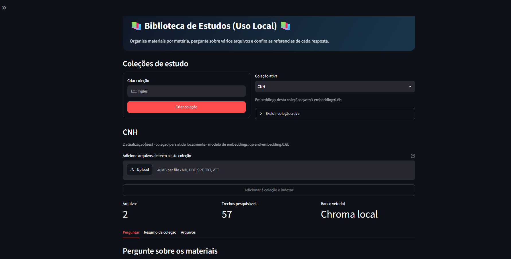
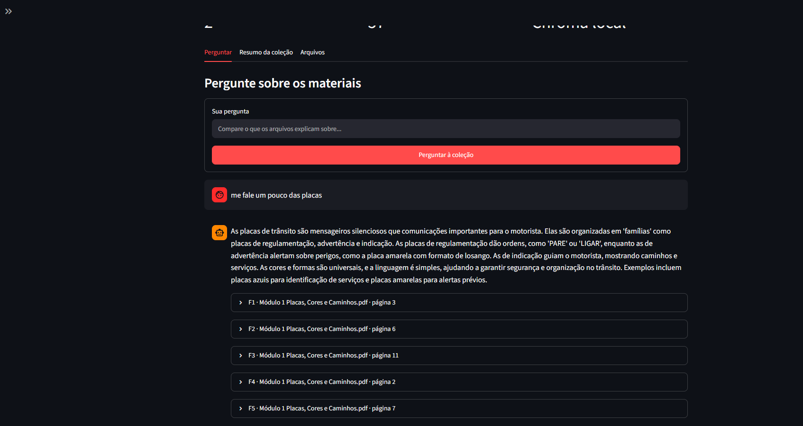
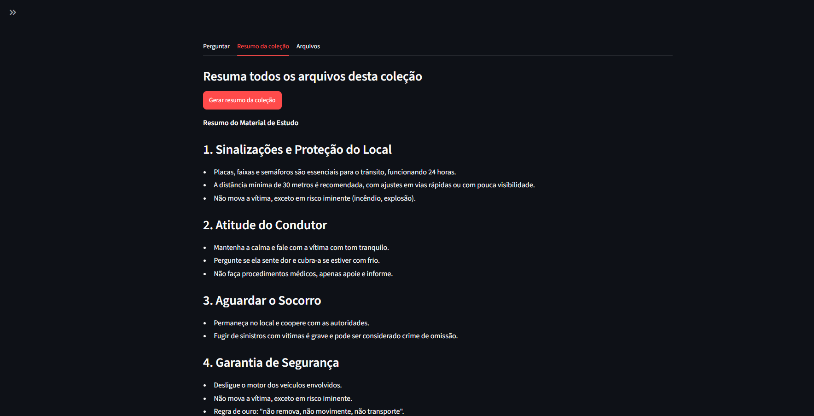
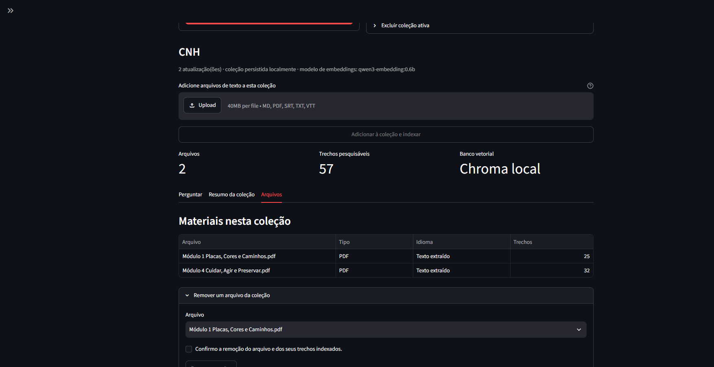

# Biblioteca de Estudos Local

Assistente de estudos que organiza materiais por matéria e responde perguntas sobre os arquivos de cada coleção. O app extrai texto de PDFs, divide os materiais em trechos, busca as partes relevantes e mostra as fontes usadas. O LLM e os embeddings são executados localmente pelo Ollama; não é necessária uma chave de API paga.

## O que o app faz

- Utiliza-se de um fluxo RAG
- Cria coleções locais por matéria, como Biologia ou História.
- Aceita TXT, MD, SRT, VTT e PDFs com texto selecionável.
- Responde perguntas com busca híbrida: combina busca vetorial no Chroma e busca lexical BM25, fundidas por Reciprocal Rank Fusion (RRF); mostra as fontes e páginas usadas.
- Avalia se os trechos recuperados sustentam a resposta: o modelo classifica a evidência como suficiente, parcial ou insuficiente. Se a busca não encontrar nenhum candidato, a resposta de recusa é exibida sem carregar o LLM.
- Pode reordenar candidatos com um reranker local multilingual opcional. Ele compara pergunta e trecho diretamente, não aplica um limite de score e não substitui a busca híbrida.
- Usa um histórico das ultimas quatro trocas para gerar as próximas por questão de praticidade (melhoria considerada).
- Gera um resumo de todos os arquivos de uma coleção.
- Salva trechos e embeddings pesquisáveis no Chroma local; mantém o texto integral e os metadados em arquivos locais.
- Evita adicionar o mesmo arquivo duas vezes à mesma coleção e permite remover arquivos ou excluir uma coleção inteira.
- Limita cada arquivo enviado a 25 MB e cada envio múltiplo a 50 MB no total.
- Limita PDFs a 500 páginas e calcula embeddings em lotes de 16 trechos para reduzir picos de memória.

## Tecnologias

- Streamlit: interface do app.
- LangChain: prompts, divisão do texto, integração com Chroma e Ollama.
- BM25 e Reciprocal Rank Fusion: recuperam termos literais e combinam as posições da busca lexical e vetorial.
- Ollama: modelo local de chat e modelo local de embeddings.
- Chroma: banco vetorial persistente para coleções e trechos pesquisáveis.
- pypdf: extração de texto e páginas de PDFs.

## Informações Extras sobre Decisões

- Chroma escolhido por simplicidade e por cair bem nas funcionalidades do sistema como armazenamento local, coleções e gerenciamento de metadados.
- Apresentamos 3 chains para contextulização, resposta e resumo.
- Usamos um retriever híbrido com busca semântica e BM25 para encontrar trechos com significados parecidos e procurando também palavras chaves.
- RRF usado para levar em consideração a pontuação das duas buscas.
- Reranker usado para comparar os trechos com as perguntas e reordená-los.
- Modelo de respostas (qwen3:1.7b) usa temperatura = 0 para reduzir a variação e favorecer respostas mais consistentes e contexto = 8192 para poder acomodar boa parte em conteudo e ainda sim não consumir tanta memória sendo um equilíbrio (Os valores são escolhas práticas e não configurações comprovadamente ideais para todo computador ou coleção).

## Requisitos

- Windows 10 ou posterior.
- Python 3.11 ou 3.12.
- [Ollama para Windows](https://ollama.com/download/windows).
- Internet para instalar as dependências e baixar os modelos pela primeira vez. Depois, o Ollama e o banco Chroma funcionam localmente.

## 1. Baixe os modelos do Ollama

Abra o PowerShell com o Ollama instalado e rode:

```powershell
ollama pull qwen3:1.7b
ollama pull qwen3-embedding:0.6b
```

O projeto usa `qwen3:1.7b` para respostas e resumos, e `qwen3-embedding:0.6b` para criar e consultar os embeddings. Se o computador tiver mais memória, você pode baixar outro modelo de chat e selecioná-lo na barra lateral.

O Ollama precisa estar instalado e em execução no computador. Confira os modelos baixados com `ollama list`. Por padrão, o app se conecta a `http://localhost:11434`; o endereço e o modelo de chat também podem ser alterados na barra lateral. O modelo de embeddings escolhido vale para novas coleções; cada coleção existente guarda o modelo usado ao ser criada.

Opcionalmente, copie `.env.example` para `.env` e ajuste os valores antes de iniciar o app:

```powershell
Copy-Item .env.example .env
```

O `.env` é local e está ignorado pelo Git. 

## 2. Instale as dependências

No terminal do VS Code, dentro desta pasta, crie e ative um ambiente virtual:

```powershell
python -m venv .venv
.\.venv\Scripts\Activate.ps1
python -m pip install --upgrade pip
pip install -r requirements.txt
```

Use Python 3.11 ou 3.12 no terminal.

As dependências usam `chromadb==1.5.9` e `langchain-chroma==1.1.0`, fixadas em `requirements.txt` para manter compatíveis a configuração do índice HNSW e a integração LangChain.

Para instalar as ferramentas de desenvolvimento e rodar os testes automatizados:

```powershell
pip install -r requirements-dev.txt
pytest
```
*Projeto já testado usando Pytest com sucesso*

O campo de modelo de embeddings na barra lateral vale somente para coleções novas. Coleções existentes continuam consultando com o modelo salvo na criação, evitando misturar vetores gerados por modelos diferentes.

O reranker é opcional e não faz parte das dependências padrão. Para instalá-lo, rode `pip install -r requirements-reranker.txt`; depois informe `BAAI/bge-reranker-v2-m3` no campo **Reranker local (opcional)**. O primeiro uso baixa o modelo e precisa de internet.

Na busca híbrida, o Chroma e o BM25 retornam candidatos separadamente. O app combina os rankings por RRF e envia até cinco trechos para avaliação de evidências. A presença de resultados não significa automaticamente que a pergunta pode ser respondida: o LLM deve classificá-los como suficientes, parciais ou insuficientes. Se ambos os rankings estiverem vazios, o fluxo recusa a resposta sem carregar o LLM. Um conjunto não vazio ainda pode conter trechos irrelevantes; a classificação usa o LLM local e deve ser avaliada com perguntas rotuladas. O índice BM25 é reconstruído quando os arquivos da coleção mudam e fica em cache durante o uso.

Para medir a recuperação e a recusa com perguntas e rótulos do seu próprio acervo, siga o procedimento em [evals/README.md](evals/README.md). Não há limite universal de relevância configurado. O reranker local opcional pode ser comparado com a busca atual; ele exige dependências adicionais, memória e download inicial do modelo.

Para apagar uma coleção e todos os seus textos e vetores, abra **Excluir coleção ativa** e confirme a ação. A exclusão é permanente.

## 3. Execute

No VS Code, selecione o interpretador dentro de `.venv` usando `Ctrl+Shift+P` → **Python: Select Interpreter**. Depois rode:

```powershell
streamlit run app.py
```

Crie uma coleção na página, envie arquivos e clique em **Adicionar à coleção e indexar**. O Ollama precisa estar aberto no computador para criar embeddings, responder perguntas e gerar resumos.

## Persistência

O Chroma cria e mantém o banco vetorial em `data/chroma`. Os trechos e embeddings pesquisáveis ficam no Chroma; o texto integral e os metadados dos arquivos ficam em `data/sources`, fora do índice vetorial. As pastas são criadas automaticamente e mantêm os materiais quando você fecha o app. Em uma instalação nova, crie coleções e adicione os materiais pela interface. O histórico de perguntas é temporário e vale apenas para a sessão atual do Streamlit.

A pasta `data/` está no `.gitignore`, então coleções e documentos pessoais não entram no GitHub. O histórico das perguntas fica na sessão atual do Streamlit e é descartado quando a sessão é reiniciada; salvar conversas para uso posterior pode ser uma melhoria futura.

> O app não abre nem mantém um banco SQLite próprio. O Chroma local cria internamente `data/chroma/chroma.sqlite3` para seus metadados; esse arquivo faz parte do banco Chroma e é esperado.

## Arquivos principais

```text
app.py                 interface Streamlit e fluxo da aplicação
pipeline.py            leitura de arquivos, divisão de texto, prompts e busca Chroma
storage.py             operações de coleções, fontes e trechos no Chroma
requirements.txt       dependências Python
requirements-dev.txt   dependências e ferramentas para desenvolvimento e testes
tests/                 testes automatizados
evals/                 conjunto de exemplo e ferramenta de avaliação calibrada com rótulos locais
data/chroma/           coleções de trechos e embeddings (ignorado pelo Git)
data/sources/          conteúdo integral e metadados dos arquivos (ignorado pelo Git)
```
## Fotos










*Esse projeto foi readaptado de uma tentativa de fazer um resumidor de vídeos do youtube que foi descontinuado por conta de conflitos com a plataforma*
